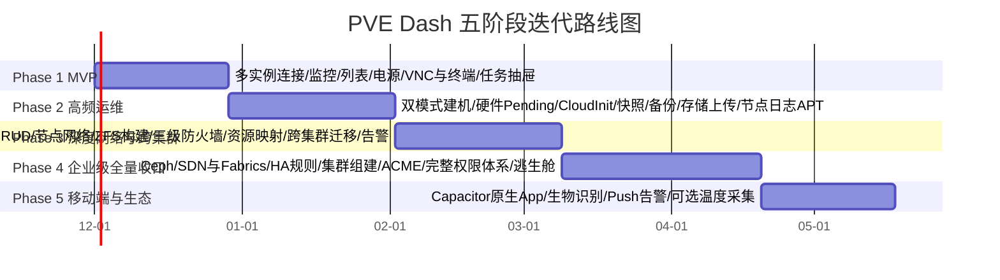

# PVE Dash 产品需求文档（PRD）

> **版本**：v1.0  
> **日期**：2026-11-26  
> **产品定位**：覆盖 Proxmox VE 95%+ 全量管理能力、原生多集群统一管控、桌面 Web 与移动 App 一体化的现代化虚拟化控制平面。

---

## 1. 产品背景与核心目标

### 1.1 痛点总结
1. **交互陈旧且效率低**：原生 PVE Web 基于 ExtJS，配置项散落在多层弹窗中，创建一台常用虚拟机需要连续点 8 个标签页，且缺少全局快捷搜索（`Cmd+K`）、批量操作和现代视觉层级。
2. **多独立 PVE 管理割裂**：许多用户同时拥有多套未组集群的 PVE（家庭 Homelab、办公室测试机、云端托管节点），原生界面必须打开多个标签页分别登录，无法统一看水位、搜机器或跨集群迁移。
3. **移动端几乎不可用**：原生界面无响应式布局，手机上既无法紧急重启故障 VM，也无法正常操作终端。
4. **多版本混用痛点**：不同 PVE 节点可能停留在 7.4 / 8.x / 9.x，缺乏统一的能力适配与平滑升级体验。

### 1.2 产品设计原则
- **全量覆盖，渐进披露（Progressive Disclosure）**：核心目标覆盖 PVE 95%+ 功能，但界面绝不堆砌参数——日常高频操作一屏直达，高级专业参数默认折叠于「高级选项 / 专家模式」中。
- **多 PVE 一等公民**：单台 PVE、单集群多节点、多套跨网独立集群，在产品架构上完全统一处理。
- **版本自适应**：基于版本探测动态展示或优雅降级 PVE 7.4 / 8.x / 9.x 特性，永不向用户裸露 `404/501` 协议报错。
- **安全防呆**：销毁 VM、格式化磁盘、强制停止、清理备份等高危操作必须具备二次确认与目标名称校验，所有写操作留审计日志。
- **Web 优先，移动同源**：从第一天起做响应式布局与 PWA，Phase 5 基于同一套代码通过 Capacitor 打包原生 iOS / Android App。

---

## 2. 目标用户与典型场景

| 用户画像 | 典型规模 | 核心诉求 |
| :--- | :--- | :--- |
| **Homelab / AIO 极客玩家** | 1–4 套独立 PVE，10–50 个 VM/LXC | 颜值高、暗黑模式、一行 Docker 部署、手机随时应急开关机和进终端、一键模板建机、看磁盘 SMART 与系统负载 |
| **中小企业系统运维工程师** | 1–3 套 PVE 集群（3–15 节点），50–300 台业务机 | 统一监控大盘、高效批量操作、权限与审计清晰、定时备份与快照可靠、告警及时推送至企微/飞书/钉钉/Telegram |
| **虚拟化重度管理员（Ceph/SDN/HA）** | 多套超融合集群 | 完整管理 Ceph OSD/Pool、SDN Zone/VNet/Fabric、HA 规则、防火墙策略、硬件直通映射，尽量少回跳原版 PVE |

---

## 3. 全量功能需求全景矩阵（13 大功能域）

> **阶段标识说明**：`P1` = Phase 1 (MVP) · `P2` = Phase 2 (高频运维) · `P3` = Phase 3 (网络/存储深度与跨集群) · `P4` = Phase 4 (企业全量收口) · `P5` = Phase 5 (移动 App 与增强生态)  
> **版本标识说明**：`7.4+` = 全基线支持 · `8.0+` / `8.1+` / `8.2+` / `9.0+` / `9.1+` = 按探测版本号动态解锁

---

### 域 1：多实例与集群连接中心（PVE Dash 平台核心）

| 需求 ID | 功能点 | 详细描述 | 对应 PVE API / 机制 | 阶段 |
| :--- | :--- | :--- | :--- | :---: |
| `INS-01` | 实例注册与编辑 | 添加单机 PVE 或 PVE 集群；支持填写别名、分组（如“家里/生产/测试”）、自定义标签与颜色 | 平台本地存储 | `P1` |
| `INS-02` | 多节点高可用入口（Failover） | 单个集群支持配置多个节点 Endpoint（主/备列表），主节点失联时自动无缝切换备用节点 | 连接池健康探活 | `P1` |
| `INS-03` | 双模式鉴权配置 | 主推 API Token（`user@realm!tokenid` + `secret`）；可选绑定账号密码/Ticket 备用凭据以兼容特殊版本 `termproxy` | `/access/ticket` / `PVEAPIToken` | `P1` |
| `INS-04` | TLS 证书策略 | 支持 3 种模式：① 系统/自定义 CA 严格校验；② **TOFU 首次连接指纹锁定（默认推荐）**；③ 内网跳过校验（带风险提示） | Go `tls.Config` | `P1` |
| `INS-05` | 连通性测试与版本/能力探测 | 保存前一键测试连通性，自动识别单机/集群拓扑、PVE 版本号及可用能力清单 | `GET /version`, `/cluster/status` | `P1` |
| `INS-06` | 实例启停与状态隔离 | 支持手动禁用/启用某实例；离线实例在全局标灰提示，绝不阻塞在线实例加载 | 并发隔离聚合 | `P1` |

---

### 域 2：全局总览与实时遥测监控

| 需求 ID | 功能点 | 详细描述 | 对应 PVE API | 阶段 |
| :--- | :--- | :--- | :--- | :---: |
| `OVR-01` | 跨实例汇总大盘 | 聚合展示所有在线 PVE 的总 vCPU/物理核使用率、总内存/已用内存、总存储容量、在线/离线节点数、运行中/停止 VM & LXC 数量 | 聚合 `GET /cluster/resources` | `P1` |
| `OVR-02` | 实例与节点健康矩阵 | 按实例分组卡片展示各节点状态、负载 LoadAvg、Uptime、Quorum 状态、CPU/RAM 水位条，离线/异常高亮 | `/cluster/status`, `/nodes` | `P1` |
| `OVR-03` | 全局命令面板（`Cmd+K`） | 支持按 VMID、名称、IP（来自 Guest Agent/配置）、标签、节点名瞬间跨所有 PVE 检索，并支持直接执行动作（开机/控制台/跳转） | 聚合索引缓存 | `P1` |
| `OVR-04` | 历史性能趋势图（RRD） | 节点/VM/LXC 级别支持查看 `hour / day / week / month / year` 粒度的 CPU、内存、网络收发、磁盘 I/O（`AVERAGE` / `MAX` 切换） | `GET /nodes/{node}/.../rrddata` | `P1` |
| `OVR-05` | Top N 负载热点排行 | 全局/单实例内按 CPU、内存、网络流量、磁盘 IO 排序定位异常高负载 Guest | 聚合计算 | `P2` |
| `OVR-06` | 可选宿主机硬件传感器扩展 | 接入可选轻量扩展（SSH/Host Agent）展示 CPU 封装温度、主板温度、风扇转速、UPS 状态 | 非侵入可选扩展 | `P5` |

---

### 域 3：数据中心 / 集群级管理（`/cluster`）

| 需求 ID | 功能点 | 详细描述 | 对应 PVE API | 版本 | 阶段 |
| :--- | :--- | :--- | :--- | :---: | :---: |
| `CLS-01` | 集群概览与日志 | 查看集群 Quorum 票数、成员心跳、全局集群事件日志 | `/cluster/status`, `/cluster/log` | 7.4+ | `P1` |
| `CLS-02` | 集群选项设置 | 管理键盘布局、迁移网络/模式（secure/insecure）、默认控制台、NextID 范围、标签样式、HA 关机策略、带宽限制 | `GET/PUT /cluster/options` | 7.4+ | `P3` |
| `CLS-03` | 全局定时备份任务 | CRUD 定时备份策略（周期表达式、包含/排除 VM、压缩算法、通知策略、保留规则 Prune）、立即运行、查看未纳入备份的 Guest 清单 | `/cluster/backup`, `/cluster/backup-info/not-backed-up` | 7.4+ | `P2` |
| `CLS-04` | ZFS 复制任务 | 查看与管理集群级 ZFS 周期复制任务 | `/cluster/replication` | 7.4+ | `P3` |
| `CLS-05` | 集群防火墙 | 开关与 Options、安全规则（拖拽排序/启用/复制）、Security Groups、IP Aliases、IPSets | `/cluster/firewall/*` | 7.4+ | `P3` |
| `CLS-06` | 硬件资源映射 | 管理跨节点的 PCI 设备、USB 设备与目录（Virtiofs）映射，屏蔽单节点总线号差异 | `/cluster/mapping/{pci,usb,dir}` | 8.0+ / 8.2+ | `P3` |
| `CLS-07` | 通知系统（Targets & Matchers） | 配置通知目标（SMTP/Sendmail/Gotify/Webhook）、匹配路由规则、测试发送 | `/cluster/notifications/*` | 8.1+ | `P3` |
| `CLS-08` | 高可用（HA）完整管理 | HA 状态与维护模式、HA 资源托管（started/stopped/disabled/ignored）；**兼容 PVE 7/8 HA Groups 与 PVE 9+ HA Rules（亲和性/反亲和性）** | `/cluster/ha/{status,resources,groups,rules}` | 7.4+ / 9.0+ | `P4` |
| `CLS-09` | 集群组建与节点加入 | 创建新集群、复制 Join Information、将节点加入现有集群、查看 Corosync/QDevice 配置 | `/cluster/config/*` | 7.4+ | `P4` |
| `CLS-10` | ACME 账户与 DNS 验证插件 | 注册 Let's Encrypt/自定义 ACME 账户、配置 Cloudflare/Aliyun 等 DNS-01 Challenge 插件 | `/cluster/acme/*` | 7.4+ | `P4` |
| `CLS-11` | 外部指标服务器 | 配置向 InfluxDB / Graphite 推送监控指标 | `/cluster/metrics/server` | 7.4+ | `P4` |

---

### 域 4：节点管理（`/nodes/{node}`）

| 需求 ID | 功能点 | 详细描述 | 对应 PVE API | 版本 | 阶段 |
| :--- | :--- | :--- | :--- | :---: | :---: |
| `NOD-01` | 节点详情与电源控制 | 节点 CPU/内存/Swap/Rootfs/内核版本/PVE 版本展示；节点重启、关机、Wake-on-LAN 唤醒 | `/nodes/{node}/status`, `/wakeonlan` | 7.4+ | `P1` |
| `NOD-02` | 节点宿主机终端（Shell） | 直接在 Web/App 打开宿主机交互式 Shell（`xterm.js`），支持多标签与分屏 | `/nodes/{node}/termproxy` + `vncwebsocket` | 7.4+ | `P1` |
| `NOD-03` | 节点级 Guest 批量调度 | 一键 Start All、Stop All、Suspend All、Migrate All（带并发度与超时配置） | `/nodes/{node}/{startall,stopall,suspendall,migrateall}` | 7.4+ | `P2` |
| `NOD-04` | 系统服务与日志 | Systemd 服务列表与启停/重启；Syslog 与 Journald 日志时间范围过滤与关键字搜索 | `/nodes/{node}/services`, `/syslog`, `/journal` | 7.4+ | `P2` |
| `NOD-05` | 软件包更新与 APT 源管理 | 刷新软件包列表、查看待升级包与 Changelog、通过终端一键执行升级、管理 APT 仓库（兼容 `.list` 与 PVE 9 `.sources`） | `/nodes/{node}/apt/{update,versions,repositories}` | 7.4+ / 9.0+ | `P2` |
| `NOD-06` | 本地物理磁盘与 SMART 健康 | 磁盘列表（NVMe/SSD/HDD、序列号、磨损度、挂载状态）、查看完整 SMART 属性表、Wipe Disk、Init GPT | `/nodes/{node}/disks/{list,smart,wipedisk,initgpt}` | 7.4+ | `P2` |
| `NOD-07` | 本地存储卷构建 | 创建与管理 Directory、LVM、LVM-Thin、**ZFS Pool（创建 RAIDZ/Mirror、查看状态与 Scrub、销毁）** | `/nodes/{node}/disks/{directory,lvm,lvmthin,zfs}` | 7.4+ | `P3` |
| `NOD-08` | 节点网络配置 | 管理物理网卡、Linux Bridge (`vmbr`)、Bond、VLAN、OVS 接口；**可视化 Diff 预览挂起改动，一键 Apply 或 Revert** | `/nodes/{node}/network` | 7.4+ | `P3` |
| `NOD-09` | DNS、Hosts、时区与证书 | 配置节点 DNS/搜索域、`/etc/hosts`、时区；上传自定义 SSL 证书或一键通过 ACME 申请/续签证书 | `/nodes/{node}/{dns,hosts,time,certificates}` | 7.4+ | `P3`/`P4` |
| `NOD-10` | 节点防火墙与硬件枚举 | 节点级防火墙规则与实时日志；查看宿主机 PCI 设备（含 IOMMU Group）和 USB 设备列表 | `/nodes/{node}/firewall/*`, `/hardware/{pci,usb}` | 7.4+ | `P3` |
| `NOD-11` | 订阅信息管理 | 查看/设置/检查/删除节点订阅 Key | `/nodes/{node}/subscription` | 7.4+ | `P4` |

---

### 域 5：QEMU 虚拟机全生命周期（`/nodes/{node}/qemu`）

| 需求 ID | 功能点 | 详细描述 | 对应 PVE API | 版本 | 阶段 |
| :--- | :--- | :--- | :--- | :---: | :---: |
| `QEM-01` | 统一清单与多维筛选 | 支持跨实例/单节点查看全部 VM；按状态、标签、资源池、节点筛选；行内展示实时 CPU/RAM/IP；支持多选批量开关机与打标签 | `/cluster/resources`, `/nodes/{node}/qemu` | 7.4+ | `P1` |
| `QEM-02` | 电源生命周期控制 | 开机（Start）、优雅关机（Shutdown）、强制断电（Stop）、重启（Reboot）、强制复位（Reset）、暂停/休眠（Suspend）、恢复（Resume）、销毁（Destroy，可选清理未引用盘与关联任务） | `/qemu/{vmid}/status/*`, `DELETE /qemu/{vmid}` | 7.4+ | `P1` |
| `QEM-03` | 多协议远程控制台 | ① **noVNC**（缩放、全屏、发送组合键如 `Ctrl+Alt+Del`、粘贴辅助）；② **xterm.js 串口控制台**；③ **SPICE `.vv` 下载** | `vncproxy`, `termproxy`, `spiceproxy`, `vncwebsocket`, `sendkey` | 7.4+ | `P1` |
| `QEM-04` | 双模式创建向导 | **快速模式**（3 步：选模板/ISO → 选预设规格 → 启动）与 **完整专家模式**（覆盖 OS/System/Disks/CPU/Memory/Network/Cloud-Init 全部参数），自动填充 `/cluster/nextid` | `POST /nodes/{node}/qemu`, `/cluster/nextid` | 7.4+ | `P2` |
| `QEM-05` | 完整硬件管理与 Pending Diff | 可视化管理 Memory（含 Balloon）、CPU（核/插槽/类型/NUMA/Flags）、BIOS(SeaBIOS/OVMF)+EFI、Machine(q35/i440fx)+vTPM、Display、磁盘（增/改/分离/删除/**在线扩容 `resize`**/**在线跨存储迁移 `move_disk`**）、光驱 ISO 挂载、网卡（Bridge/VNet/VLAN/限速/多队列/断网）、PCI/USB/串口/音频/Virtiofs；**高亮显示 `pending` 待重启生效变更并支持一键撤销** | `/qemu/{vmid}/{config,pending,resize,move_disk}` | 7.4+ | `P2` |
| `QEM-06` | Cloud-Init 配置中心 | 表单化编辑 User、Password、SSH 公钥库、DNS、IPv4/IPv6 静态/DHCP、Custom Snippets，一键重新生成 Cloud-Init 镜像 | `/qemu/{vmid}/config`, `/cloudinit` | 7.4+ | `P2` |
| `QEM-07` | QEMU Guest Agent 面板 | 展示 Guest 实时网卡 IPv4/IPv6、OS 版本、文件系统挂载与占用；支持在线 `fstrim`、修改密码、执行命令（`agent/exec`） | `/qemu/{vmid}/agent/*` | 7.4+ | `P2` |
| `QEM-08` | 快照树管理 | 树状可视化展示快照继承关系、创建（可选含内存状态 `vmstate`）、修改备注、一键回滚、删除 | `/qemu/{vmid}/snapshot/*` | 7.4+ | `P2` |
| `QEM-09` | 克隆、模板与同集群迁移 | 完整克隆/链接克隆、一键转为模板、同集群在线/离线迁移（含本地存储映射） | `/qemu/{vmid}/{clone,template,migrate}` | 7.4+ | `P2` |
| `QEM-10` | 虚拟机选项完整配置 | 开机自启与启动顺序/延迟、**拖拽式 Boot Order 引导排序**、OS 类型、QEMU Agent 选项、保护锁（Protection）、Hotplug、KVM 硬件虚拟化、Tablet、Localtime 等 | `/qemu/{vmid}/config` | 7.4+ | `P2` |
| `QEM-11` | 备份与文件级恢复 | 单机立即备份（`vzdump`，支持 stop/suspend/snapshot 与 zstd/lzo/gzip）、备份列表、保护锁、改备注、恢复到新/原 VMID、PBS 备份单文件浏览与下载（`file-restore`） | `/nodes/{node}/vzdump`, `/storage/{s}/file-restore/*` | 7.4+ | `P2` |
| `QEM-12` | **跨独立 PVE 远程迁移** | 在不同独立 PVE 实例间发起在线/离线迁移（自动构造目标集群 Token、存储映射、网桥映射） | `POST /qemu/{vmid}/remote_migrate` | 8.0+ | `P3` |
| `QEM-13` | 外部镜像导入（ESXi / OVA / OVF） | 从 ESXi 存储源或上传的 OVA/OVF 读取元数据并向导式导入为 PVE 虚拟机 | `/storage/{s}/import-metadata` + `POST /qemu` | 8.2+ | `P3` |
| `QEM-14` | VM 防火墙与复制 | VM 级防火墙开关/规则/Alias/IPSet/实时日志；单机 ZFS 复制任务配置 | `/qemu/{vmid}/firewall/*`, `/cluster/replication` | 7.4+ | `P3` |
| `QEM-15` | 高级排错与逃生舱 | 原始配置键值对查看与高级编辑、QEMU Monitor（PVE 7/8 兼容）、一键跳转原版 PVE 对应节点 | `/qemu/{vmid}/config`, `/monitor` | 7.4+ | `P4` |

---

### 域 6：LXC 容器全生命周期（`/nodes/{node}/lxc`）

| 需求 ID | 功能点 | 详细描述 | 对应 PVE API | 版本 | 阶段 |
| :--- | :--- | :--- | :--- | :---: | :---: |
| `LXC-01` | 列表、状态与生命周期 | 与 VM 同屏或分标签管理；开机/关机/强停/重启/销毁；实时 CPU/内存/Swap/磁盘统计 | `/nodes/{node}/lxc/*` | 7.4+ | `P1` |
| `LXC-02` | 容器交互式终端 | 默认 `xterm.js` 秒开容器 Shell，并支持切换 noVNC | `/lxc/{vmid}/termproxy`, `vncproxy` | 7.4+ | `P1` |
| `LXC-03` | 创建容器向导（模板 + OCI） | 支持传统 LXC 模板创建；**PVE 9.1+ 自动启用「从 OCI / Docker 镜像创建」模式**，可视化配置环境变量、Entrypoint、非特权隔离与嵌套 Docker 特性 | `POST /nodes/{node}/lxc` | 7.4+ / 9.1+ | `P2`/`P3` |
| `LXC-04` | 资源、存储卷与网络配置 | 调整 CPU 核数/限额、Memory/Swap、Root Disk 与 Mount Points（增/改/扩容 `resize`/跨存储迁移 `move_volume`）、多网卡（IPv4/IPv6/DHCP/VLAN/防火墙/限速）、DNS、实时网卡 IP 查看（`/interfaces`） | `/lxc/{vmid}/{config,pending,resize,move_volume,interfaces}` | 7.4+ | `P2` |
| `LXC-05` | 容器选项与 Features | 特权/非特权提示（PVE 9 自动检查 `Sys.Modify`）、Features 开关（`nesting`/`keyctl`/`fuse`/`mount`）、开机自启、Console 模式、保护锁 | `/lxc/{vmid}/config` | 7.4+ | `P2` |
| `LXC-06` | 快照、克隆、模板、备份与迁移 | 快照树管理、克隆、转模板、备份与文件级恢复、同集群迁移与跨实例 `remote_migrate` | `/lxc/{vmid}/{snapshot,clone,template,migrate,remote_migrate}` | 7.4+ | `P2`/`P3` |
| `LXC-07` | 容器级防火墙与复制 | 容器防火墙规则/Alias/IPSet/日志、ZFS 复制 | `/lxc/{vmid}/firewall/*` | 7.4+ | `P3` |

---

### 域 7：存储中心（`/storage` & `/nodes/{node}/storage`）

| 需求 ID | 功能点 | 详细描述 | 对应 PVE API | 版本 | 阶段 |
| :--- | :--- | :--- | :--- | :---: | :---: |
| `STR-01` | 存储池概览与内容浏览 | 跨实例/单节点查看全部存储容量水位、类型、支持内容标签；按分类浏览 VM 磁盘、CT 卷、ISO、CT 模板、备份包、Snippets、Import | `/storage`, `/nodes/{node}/storage/{s}/content` | 7.4+ | `P1`/`P2` |
| `STR-02` | 大文件流式上传 | 上传 ISO、CT 模板、OVA/VMDK 至指定存储；后端零内存落盘流式直传，前端实时进度条与取消 | `POST /nodes/{node}/storage/{s}/upload` | 7.4+ | `P2` |
| `STR-03` | URL 直链下载镜像 | 输入 HTTP/HTTPS 镜像地址，先预览文件名与大小（`query-url-metadata`），支持选填 SHA256 校验和让 PVE 节点后台直拉 | `/query-url-metadata`, `/storage/{s}/download-url` | 7.4+ | `P2` |
| `STR-04` | 官方 CT 模板库与 OCI 拉取 | 浏览并一键下载 Proxmox 官方/TurnKey LXC 模板（`aplinfo`）；PVE 9.1+ 支持从 Registry 拉取 OCI 镜像 | `/nodes/{node}/aplinfo`, OCI pull API | 7.4+ / 9.1+ | `P2`/`P3` |
| `STR-05` | 全局存储配置 CRUD | 添加/编辑/删除全部主流存储后端：Directory、LVM、LVM-Thin、ZFS、NFS、CIFS/SMB、**Proxmox Backup Server (PBS)**、Ceph RBD/CephFS、iSCSI、Btrfs、ESXi 导入源，含节点限定与 Prune 保留策略 | `GET/POST/PUT/DELETE /storage` | 7.4+ | `P3` |
| `STR-06` | 备份清理与校验 | 查看和执行 Prune Backups 模拟/清理、PBS 校验任务 | `/storage/{s}/prunebackups` | 7.4+ | `P3` |

---

### 域 8：软件定义网络（SDN `/cluster/sdn`）

| 需求 ID | 功能点 | 详细描述 | 对应 PVE API | 版本 | 阶段 |
| :--- | :--- | :--- | :--- | :---: | :---: |
| `SDN-01` | Zones / VNets / Subnets 管理 | 创建与管理 Simple / VLAN / QinQ / VXLAN / EVPN Zones、VNets 与子网（含 Gateway、SNAT、DHCP Range） | `/cluster/sdn/{zones,vnets}` | 8.1+ | `P4` |
| `SDN-02` | Controllers / IPAM / DNS | 配置 BGP/EVPN/ISIS 控制器、IPAM（PVE/NetBox/phpIPAM）与 DNS 插件 | `/cluster/sdn/{controllers,ipams,dns}` | 8.1+ | `P4` |
| `SDN-03` | **SDN Fabrics 路由底层** | 配置 OpenFabric / OSPF 自动化底层路由与节点接口 | `/cluster/sdn/fabrics/*` | 9.0+ | `P4` |
| `SDN-04` | 待下发 Diff 与集群 Apply | 展示待生效的 SDN 变更并一键推送全集群生效，查看各节点 SDN 运行态 | `PUT /cluster/sdn`, `/nodes/{node}/sdn/*` | 8.1+ | `P4` |

---

### 域 9：Ceph 超融合存储（`/cluster/ceph` & `/nodes/{node}/ceph`）

| 需求 ID | 功能点 | 详细描述 | 对应 PVE API | 版本 | 阶段 |
| :--- | :--- | :--- | :--- | :---: | :---: |
| `CPH-01` | Ceph 全局健康大盘 | 聚合显示 `HEALTH_OK/WARN/ERR` 详情、PG 分布状态、读写吞吐/IOPS/延迟图表、容量水位与告警列表 | `/cluster/ceph/status`, `/nodes/{node}/ceph/status` | 7.4+ | `P4` |
| `CPH-02` | Monitor / Manager / MDS 管理 | 列表展示与创建/启停/销毁 MON、MGR、MDS 服务 | `/nodes/{node}/ceph/{mon,mgr,mds}` | 7.4+ | `P4` |
| `CPH-03` | OSD 拓扑与全操作 | 树状/表格查看 OSD 所在节点与磁盘、延迟/使用率；支持创建 OSD、Start/Stop、Out/In、Scrub/Deep-Scrub、Destroy | `/nodes/{node}/ceph/osd/*` | 7.4+ | `P4` |
| `CPH-04` | Pools / CephFS / 配置与日志 | 创建/编辑/删除 Pool（副本数/最小副本/PG Autoscaler/CRUSH Rule）、CephFS 管理、查看 `ceph.conf` 与 Ceph 日志 | `/nodes/{node}/ceph/{pool,fs,cfg,log,rules}` | 7.4+ | `P4` |

---

### 域 10：资源池与权限管理（`/pools` & `/access`）

| 需求 ID | 功能点 | 详细描述 | 对应 PVE API | 版本 | 阶段 |
| :--- | :--- | :--- | :--- | :---: | :---: |
| `IAM-01` | 资源池（Pools） | 资源池 CRUD，绑定/解绑 VM、LXC 与存储 | `/pools/*` | 7.4+ | `P3` |
| `IAM-02` | 用户、组与 API Token 管理 | CRUD 用户与用户组；签发/吊销 API Token（支持权限分离开关、过期时间，创建后一次性展示 Secret 与复制按钮） | `/access/{users,groups}` | 7.4+ | `P4` |
| `IAM-03` | 角色与 ACL 权限树 | 角色 CRUD（**自动按 PVE 版本过滤 `VM.Monitor`/`VM.Replicate` 差异**）；可视化路径 ACL 授权 | `/access/{roles,acl}` | 7.4+ / 9.0+ | `P4` |
| `IAM-04` | 认证域（Realms）与双因素（TFA） | 管理 PAM/PVE/LDAP/AD/OpenID Connect 域与定时同步；管理用户 TOTP/WebAuthn/恢复码 | `/access/{domains,tfa}`, `/cluster/jobs/realm-sync` | 7.4+ | `P4` |

---

### 域 11：全局任务中心、审计与平台告警（PVE Dash 增强能力）

| 需求 ID | 功能点 | 详细描述 | 阶段 |
| :--- | :--- | :--- | :---: |
| `OPS-01` | 全局底部任务抽屉 | 汇聚所有 PVE 实例正在运行与最近完成的任务；实时显示进度与耗时；点击展开流式日志并支持一键中止（`DELETE /tasks/{upid}`） | `P1` |
| `OPS-02` | PVE Dash 操作审计日志 | 记录面板用户的每次写操作（操作人、来源 IP、目标实例/资源、动作、参数摘要、结果与关联 UPID），支持筛选与 CSV/JSON 导出 | `P2` |
| `OPS-03` | 跨实例智能告警引擎 | 可配置告警规则：实例/节点离线、CPU/RAM/存储水位连续超阈值、SMART 异常、备份/同步任务失败、Ceph 非 HEALTH_OK；支持推送至 **Webhook / Telegram / 企业微信 / 飞书 / 钉钉 / SMTP / 未来 App Push** | `P3` |

---

### 域 12：PVE Dash 平台系统设置

| 需求 ID | 功能点 | 详细描述 | 阶段 |
| :--- | :--- | :--- | :---: |
| `SYS-01` | 面板账号与权限 | 首次启动引导创建管理员账号；支持单人自用模式及多人团队 RBAC（控制不同成员可见/可操作哪些 PVE 实例） | `P1`（基础）/ `P4`（多用户 RBAC） |
| `SYS-02` | 面板安全设置 | 面板登录 2FA（TOTP）、会话管理与踢出、登录失败限流 | `P2` |
| `SYS-03` | 个性化偏好 | 深色（默认）/浅色/跟随系统主题、界面密度（紧凑/标准）、全局自动刷新间隔（2s/5s/10s/手动）、语言（中文/英文） | `P1` |
| `SYS-04` | 配置备份与恢复 | 导出/导入 PVE Dash 实例列表、告警规则与偏好设置（密文加密保护） | `P3` |

---

### 域 13：移动端 Web / PWA 与 Capacitor 原生 App 需求

| 需求 ID | 功能点 | 详细描述 | 阶段 |
| :--- | :--- | :--- | :---: |
| `MOB-01` | 移动优先响应式与 PWA | 375px 起无横向滚动；底部 Tab 导航；表格自动转为紧凑资源卡片；支持添加主屏幕全屏运行 | `P1` |
| `MOB-02` | 移动端控制台操作增强 | `xterm.js` 底部悬浮虚拟快捷键工具条（`ESC`/`TAB`/`CTRL`/`ALT`/`↑↓←→`/`|`/`/`/粘贴）；noVNC 双指缩放、单指拖动、虚拟键盘呼出按钮 | `P2` / `P5` |
| `MOB-03` | Capacitor iOS / Android 打包 | 一套前端代码打包原生 App；支持多服务端地址切换（家里/公司 PVE Dash 后端） | `P5` |
| `MOB-04` | 原生体验能力接入 | Face ID / 指纹应用锁、Keychain/Keystore 安全凭据存储、关键操作触觉震动反馈（Haptics）、iOS/Android 原生 Push 告警直达异常节点 | `P5` |
| `MOB-05` | （远期可选）App 零后端直连模式 | 允许 App 直接通过原生 TLS 插件连接单台 PVE（无需部署 Go 服务），降低轻量用户尝鲜门槛 | `P5+` |

---

## 4. 非功能性需求（NFR）

| 维度 | 量化指标与约束 |
| :--- | :--- |
| **响应性能** | 首屏静态资源加载 < 1.5s；全局总览聚合接口 P95 < 500ms（命中 2s 缓存 < 30ms）；单个失联 PVE 超时严格控制在 3s 内不影响整体渲染 |
| **资源占用** | Go 单二进制容器空载内存 < 40MB，10 台 PVE 并发管理内存 < 120MB；上传 10GB ISO 时容器内存峰值 < 80MB |
| **PVE 宿主机友好** | 同一实例在 2s 窗口内通过 Singleflight 合并请求，避免多标签页打爆 `pveproxy` worker |
| **兼容性** | 兼容 PVE `7.4` / `8.0–8.4` / `9.0–9.3+`；支持桌面 Chrome/Edge/Safari/Firefox 最新两代及 iOS 16+ / Android 12+ |
| **安全性** | PVE 凭据 AES-256-GCM 静态加密存储；默认支持 TLS TOFU 证书指纹锁定；HTTPS + HttpOnly Cookie / 短期 WS 票据；高危操作需输入资源 ID/名称二次确认 |
| **可访问性** | 深/浅双主题正文对比度 ≥ 4.5:1；状态绝不只靠颜色区分；支持完整键盘导航与 `prefers-reduced-motion` |

---

## 5. 五阶段实施路线图与验收标准

| 阶段 | 预估周期 | PVE 功能覆盖率 | 核心验收里程碑（Done Definition） |
| :--- | :---: | :---: | :--- |
| **Phase 1（MVP 核心可用）** | 3–4 周 | ~30%（覆盖日常 70% 高频动作） | 可同时接入至少 2 套不同版本 PVE（如 8.x + 9.x）；全局大盘秒开且单实例断网不阻塞；VM/LXC 开关机流畅；noVNC 与 xterm.js 终端稳定不断连；底部任务日志实时滚动；单 Docker 镜像跑通 |
| **Phase 2（日常全替代）** | 4–6 周 | ~65%（覆盖日常 90% 运维） | 无需打开原版 PVE 即可完成：建机/配硬件/配 Cloud-Init/扩硬盘/做快照/做备份与恢复/传 ISO/查节点 SMART 与更新系统 |
| **Phase 3（深度与多集群超越）** | 4–5 周 | ~80% | 可完成全局存储增删、节点网桥改配与回滚、创建 ZFS 池、配置三级防火墙、跨独立 PVE 迁移 VM、配置告警推送至通知渠道 |
| **Phase 4（企业全量收口）** | 5–6 周 | **95%+** | Ceph、SDN（含 9.0 Fabrics）、HA（含 9.0 Rules）、集群组建、ACME、完整用户/角色/Token/TFA 全部就绪，冷门参数支持原始配置编辑兜底 |
| **Phase 5（原生移动 App）** | 3–4 周 | 全量 + 移动专属 | 发布 iOS TestFlight 与 Android APK；Face ID 锁、移动端终端快捷键栏、告警 Push 通知全部闭环 |
