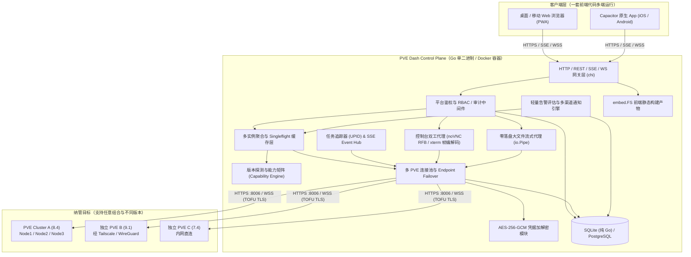

# PVE Dash 详细系统架构与 Go 后端设计方案

> **版本**：v1.0  
> **日期**：2026-11-26  
> **技术核心**：Go 单二进制控制面（内嵌前端静态资产）+ 多 PVE 并发聚合引擎 + 多版本能力适配器 + 全双工控制台 WebSocket 代理

---

## 1. 总体系统架构



### 核心架构特征
1. **无侵入外部控制面**：不在任何 PVE 宿主机安装插件或修改文件，PVE Dash 即使重启或下线也绝不影响底层虚拟机运行。
2. **前后端聚合交付**：前端 Vite 产物通过 `//go:embed` 打包进 Go 二进制，生产部署只需单个可执行文件或约 30MB 的多架构 Docker 镜像（`amd64` / `arm64`）。
3. **集中代理收口**：彻底解决浏览器 CORS、自签名证书信任、API Token 前端泄露、`pveproxy` 被多页面轮询打满以及跨集群聚合五大工程问题。

---

## 2. Go 后端目录与模块划分

采用清晰的分层结构（Standard Go Project Layout），确保随着 Phase 1 → Phase 4 接口数量增长，代码依旧可维护：

```text
pve-dash/
├── cmd/
│   └── pve-dash/
│       └── main.go                  # 入口：初始化配置、DB、连接池、调度器、HTTP 服务与优雅关闭
├── internal/
│   ├── config/                      # 环境变量 / YAML 配置加载与主密钥管理
│   ├── crypto/                      # AES-256-GCM 凭据加密、Argon2id 密码哈希、TLS 指纹计算
│   ├── store/                       # 数据库抽象层
│   │   ├── migrations/              # goose SQL 迁移文件（兼容 SQLite / PostgreSQL）
│   │   ├── queries/                 # sqlc SQL 定义
│   │   └── sqlcgen/                 # sqlc 自动生成的强类型 Repository
│   ├── pve/                         # 【核心】PVE 协议适配与多集群引擎
│   │   ├── client.go                # 底层 HTTP Client（Token/Ticket 双鉴权、TOFU TLS、重试）
│   │   ├── failover.go              # 单实例多 Endpoint 健康探测与自动故障转移
│   │   ├── pool.go                  # 全局 InstanceManager & ClientPool（并发安全缓存）
│   │   ├── capabilities.go          # SemVer 解析与版本能力矩阵（7.4 / 8.x / 9.x）
│   │   ├── errors.go                # 统一 PVE 错误语义映射（401/403/500/501/超时）
│   │   ├── upid.go                  # UPID 解析器
│   │   ├── ws_vnc.go                # noVNC 代理（vncproxy + vncwebsocket 双向转发）
│   │   ├── ws_term.go               # xterm.js 代理（termproxy + 0:/1:/2: 帧编解码 + 自动保活）
│   │   ├── stream_upload.go         # MultipartReader + io.Pipe 零内存流式上传
│   │   ├── api_cluster.go           # /cluster 领域接口封装
│   │   ├── api_node.go              # /nodes/{node} 系统/网络/磁盘/APT/服务封装
│   │   ├── api_qemu.go              # /qemu 虚拟机全生命周期封装
│   │   ├── api_lxc.go               # /lxc 容器全生命周期封装
│   │   ├── api_storage.go           # /storage 与内容管理封装
│   │   ├── api_sdn.go               # /cluster/sdn 与 Fabrics 封装
│   │   ├── api_ceph.go              # /ceph 集群与节点封装
│   │   ├── api_access.go            # /access 与 /pools 封装
│   │   └── raw.go                   # 受控原始 API 透传通道（用于高级配置与逃生舱）
│   ├── service/                     # 平台业务服务层
│   │   ├── auth_service.go          # 平台用户登录、JWT/RefreshCookie、2FA
│   │   ├── instance_service.go      # 实例 CRUD、连通性测试、TOFU 指纹确认
│   │   ├── aggregator_service.go    # 多 PVE 并发聚合（errgroup + Singleflight 2s 缓存）
│   │   ├── telemetry_hub.go         # 按需订阅 SSE 遥测与实时任务状态广播中心
│   │   ├── alert_service.go         # 定时巡检与多渠道告警推送（Webhook/TG/企微/飞书）
│   │   └── audit_service.go         # 全量写操作异步审计落库
│   └── api/                         # HTTP / SSE / WS 接入层
│       ├── router.go                # chi 路由装配
│       ├── middleware/              # JWT 校验、实例级 RBAC、高危操作确认、请求限流、审计
│       └── handler/                 # 按功能域拆分的 REST / SSE / WS Handler
├── tools/
│   └── schema-sync/                 # 基于官方 apidata.js 校验端点与生成前端表单 Schema 的辅助工具
├── web/                             # 前端源码（React/Vue + Vite + Capacitor）
│   └── embed.go                     # //go:embed dist/*
├── docs/                            # 调研、PRD 与设计文档
├── Dockerfile                       # 多阶段构建（Node build -> Go static build -> scratch/distroless）
└── docker-compose.yml
```

---

## 3. 核心技术模块详细设计

### 3.1 多 PVE 统一模型与全局资源寻址

为了彻底杜绝多套独立 PVE 间 `node="pve"`、`vmid=100` 冲突的问题，全系统强制引入 **`instanceId`（ULID/UUID）** 作为顶级命名空间：

- **全局唯一资源键（URN）**：
  - 节点：`{instanceId}:node:{node}`
  - 虚拟机：`{instanceId}:qemu:{node}:{vmid}`
  - 容器：`{instanceId}:lxc:{node}:{vmid}`
  - 存储：`{instanceId}:storage:{node}:{storage}`
- **后端 REST API 路由规范**：
  - 平台与跨实例聚合接口：
    - `GET /api/v1/overview`（跨所有在线实例聚合指标、资源数、实例健康矩阵）
    - `GET /api/v1/guests`（跨所有实例的统一 VM + LXC 清单，支持按 `instanceId/type/status/tag/q` 过滤）
    - `GET /api/v1/search?q=xxx`（全局 `Cmd+K` 极速检索）
    - `GET /api/v1/events/stream`（SSE 统一实时事件流：资源水位变化、运行中任务更新、告警触发）
  - 单实例精准管理接口（与 PVE 语义对齐，便于前端复用）：
    - `/api/v1/instances/{instanceId}/capabilities`
    - `/api/v1/instances/{instanceId}/cluster/...`
    - `/api/v1/instances/{instanceId}/nodes/{node}/...`
    - `/api/v1/instances/{instanceId}/nodes/{node}/qemu/{vmid}/...`
    - `/api/v1/instances/{instanceId}/nodes/{node}/lxc/{vmid}/...`
    - `/api/v1/instances/{instanceId}/storage/...`
    - `/api/v1/instances/{instanceId}/sdn/...`
    - `/api/v1/instances/{instanceId}/ceph/...`
    - `/api/v1/instances/{instanceId}/access/...`
    - `/api/v1/instances/{instanceId}/pools/...`
    - `ANY /api/v1/instances/{instanceId}/raw/*`（仅管理员可用，审计拦截，用于冷门参数逃生）

### 3.2 多 Endpoint Failover 与 TLS TOFU 安全策略

#### A. 集群故障自动转移（Failover）
每个 `pve_instance` 关联 1~N 个 `pve_endpoints`（按 `priority` 排序，如 `https://10.0.0.11:8006`, `https://10.0.0.12:8006`）：
1. 请求优先发往当前 `activeEndpoint`。
2. 遇到网络层错误（连接拒绝、超时、502/503/504）时，标记该 Endpoint 进入 30 秒冷却，立即平滑切换到下一个健康 Endpoint 重试幂等请求（对非幂等写请求不盲目重发，直接切主并提示）。
3. 后台探活协程每 30 秒检查一次冷却中的主节点，恢复后自动归位。

#### B. 三级 TLS 校验策略（核心解决自签名证书）
```go
type TLSMode string

const (
    TLSModeStrict   TLSMode = "strict"   // 系统根证书或用户上传自定义 CA PEM
    TLSModeTOFU     TLSMode = "tofu"     // 默认推荐：首次连接提取叶证书 SHA-256 指纹并锁定，后续每次握手严格比对
    TLSModeInsecure TLSMode = "insecure" // 显式跳过校验（仅允许测试，UI 展示醒目告警标记）
)
```
在 `TLSModeTOFU` 下，利用 Go `tls.Config.VerifyPeerCertificate` 自定义回调，直接计算 `sha256.Sum256(rawCerts[0])` 并与数据库持久化的 `cert_fingerprint` 比对。若宿主机重装或更换证书，UI 会弹出明确提示“检测到证书指纹变更”，需管理员手动确认更新——既免去了 Homelab 配置 CA 的繁琐，又具备接近 SSH `known_hosts` 的安全性。

### 3.3 多实例并发聚合与防惊群缓存

```go
// 核心聚合逻辑示意：局部容错 + 单实例超时隔离 + Singleflight
func (s *AggregatorService) GetGlobalOverview(ctx context.Context, allowedInstanceIDs []string) (*OverviewResponse, error) {
    // 1. 读 2s 短 TTL 内存缓存；并发请求用 singleflight.Group 合并，防止打爆 pveproxy
    // 2. 对每个启用的 instance 派生独立超时 ctx (3 * time.Second)
    // 3. 使用 errgroup 并发拉取 /cluster/resources 与 /cluster/status
    // 4. 单实例失败不中断其他实例，而是填入 InstanceStatus{State: "offline", Error: err.Error()}
    // 5. 返回聚合结果 + 每个实例的缓存时间戳 updatedAt，供前端展示“实时/陈旧”状态
}
```

### 3.4 多版本探测与能力矩阵（Capability Engine）

连接建立或每 10 分钟执行一次 `GET /api2/json/version`，由 Go 端统一计算下发给前端的能力 JSON：

```json
{
  "instanceId": "01JDM8X...",
  "pveVersion": "9.1.2",
  "major": 9,
  "minor": 1,
  "patch": 2,
  "isCluster": true,
  "features": {
    "resourceMappingPciUsb": true,
    "resourceMappingDir": true,
    "sdnCore": true,
    "sdnFabrics": true,
    "notificationsV2": true,
    "importEsxiOva": true,
    "haGroups": false,
    "haRules": true,
    "lxcOciImages": true,
    "aptDeb822": true,
    "aclStrictPve9": true,
    "qemuMonitorDeprecated": true,
    "remoteMigrate": true
  }
}
```

**前后端协同原则**：
- 前端根据 `features.*` 决定标签页/按钮显隐，或将不可用功能置灰并附 Tooltip（例如：“需要 Proxmox VE 9.1+，当前节点为 8.4.1”）。
- 后端针对高差异域提供统一抽象适配器：
  - **HA 适配**：PVE 7/8 读写 `/cluster/ha/groups`，PVE 9+ 优先读写 `/cluster/ha/rules`，同时支持只读查看遗留 Groups 辅助迁移。
  - **权限角色适配**：PVE 9+ 自动剔除已移除的 `VM.Monitor`，自动补充 `VM.Replicate`；创建特权 LXC 前检查当前用户/Token 是否拥有 `Sys.Modify`。
  - **APT 源适配**：同时解析传统 `.list` 与 PVE 9 deb822 `.sources` 响应结构。
- **`apidata.js` 辅助工具链（`tools/schema-sync`）**：
  - 仓库内置 PVE `7.4`、`8.4`、`9.1` 三份官方 `apidata.js` 快照。
  - 脚本自动提取各版本端点路径、入参类型、枚举值与默认值，一方面生成前端 **Schema-Driven Form** 所需的 JSON Schema（支撑 15+ 种存储类型、SDN Zone、复杂硬件选项表单），另一方面在 CI 中验证 Go 后端调用的每一个路径与字段在目标版本中合法。

### 3.5 远程控制台 WebSocket 双工代理详细设计

#### A. 一次性 WS 握手票据（避免 JWT 暴露在浏览器 URL 日志中）
由于浏览器原生 `new WebSocket(url)` 无法自由附带 `Authorization` Header，采用业界标准两步换票：
1. 前端带正常 Cookie/JWT 调用 `POST /api/v1/instances/{id}/nodes/{node}/{type}/{vmid}/console/session`，参数 `{ protocol: "vnc" | "xterm", fallbackPassword?: string }`。
2. Go 后端向 PVE 申请 `vncproxy` 或 `termproxy`，生成本地高熵短期 `sessionId`（TTL 30 秒，单次使用即焚）存入内存 Map，返回 `{ sessionId, wsUrl, vncPassword? }`。
3. 前端连接 `wss://pve-dash/api/v1/ws/console/{sessionId}`。

#### B. noVNC 与 xterm.js 代理时序

```mermaid
sequenceDiagram
    autonumber
    participant UI as Web/App 前端 (@novnc / @xterm)
    participant GO as Go BFF 控制台代理
    participant PVE as Proxmox VE (:8006)

    UI->>GO: POST .../console/session {protocol: "xterm"}
    GO->>PVE: POST /api2/json/nodes/{node}/lxc/{id}/termproxy<br/>Header: PVEAPIToken (失败自动回退 Ticket)
    PVE-->>GO: 200 {port, ticket, user, upid}
    GO-->>UI: 200 {sessionId, wsUrl}

    UI->>GO: WS Upgrade /api/v1/ws/console/{sessionId}
    GO->>PVE: WSS Upgrade .../vncwebsocket?port={port}&vncticket={urlEncode(ticket)}<br/>Header: Authorization / Cookie (双重认证!)
    PVE-->>GO: 101 Switching Protocols

    rect rgb(30, 41, 59)
        Note over GO,PVE: xterm.js 专属握手（由 Go 透明封装，前端无感）
        GO->>PVE: TextFrame "{user}:{ticket}\n"
        PVE-->>GO: TextFrame "OK"
    end

    par 上行转发与心跳保活
        UI->>GO: 标准帧 {type:"data", data:"ls -la\r"} / {type:"resize", cols:120, rows:36}
        GO->>PVE: 编码为 "0:{utf8ByteLen}:{data}" / "1:{cols}:{rows}:"
        loop 每 30 秒保活（防 PVE 5 分钟断连）
            GO->>PVE: "2:"
        end
    and 下行透传
        PVE-->>GO: 原始 PTY 字节流
        GO-->>UI: BinaryFrame 原始字节流 -> xterm.write()
    end
```



**关键实现细节**：
- `xterm` 编码 `0:{len}:{msg}` 时，Go 使用 `len([]byte(msg))` 精确计算 UTF-8 字节长度，彻底修复中文/Emoji 字符导致终端错乱断开的经典 Bug。
- 若上游为 `noVNC`，Go 代理直接按 BinaryFrame 做 RFB 协议零解析双向全双工透传，延迟最低。
- 任一侧关闭或收到 `ctx.Done()`，立刻关闭双向连接并回收 goroutine，防止泄漏。

### 3.6 大文件零落盘流式上传设计

```text
浏览器/App (8GB ISO Multipart)
   │
   ▼  req.MultipartReader() 逐块读取 (32KB buffer)
Go StreamProxy (io.Pipe) ──► 实时字节计数器 ──► 通过 SSE 推送上传进度百分比
   │
   ▼  multipart.NewWriter 流式写入上游 Request Body
PVE POST /api2/json/nodes/{node}/storage/{storage}/upload
```

- 关键配置：针对上传路由独立放宽 HTTP `WriteTimeout`（设为 0 或 2 小时），同时透传 `req.Context()` 保证用户点取消上传时立刻断开上游连接释放宿主机临时文件。

### 3.7 实时遥测与任务日志流（SSE Event Hub）

为避免成百上千次无效轮询，后端设计基于**按需订阅（Topic-based Subscription）**的 SSE Hub：
- `GET /api/v1/events/stream?topics=overview,tasks`
- 当至少有 1 个客户端订阅 `overview` 时，后端每隔 `N` 秒（默认 3s，可配）通过 Singleflight 聚合各在线实例状态并仅推送增量变化事件（`event: resources.delta`）。无人访问时，后端停止高频拉取（仅保留低频告警巡检），极大降低空闲功耗。
- 任务日志详情接口 `GET /api/v1/instances/{id}/nodes/{node}/tasks/{upid}/log/stream` 使用 SSE 持续以 `start={lastLine}` 追尾拉取 PVE 任务日志，直至 `/status` 返回 `stopped` 后推送 `event: task.done` 并自动关闭流。

---

## 4. 数据库 Schema 设计（SQLite / PostgreSQL 兼容）

默认采用纯 Go `modernc.org/sqlite`（启用 `PRAGMA journal_mode=WAL; PRAGMA foreign_keys=ON;`），数据文件存于 `./data/pve-dash.db`；大型部署可通过环境变量 `DATABASE_URL=postgres://...` 无缝切换 PostgreSQL。

```sql
-- 1. 平台用户表
CREATE TABLE users (
    id              TEXT PRIMARY KEY,
    username        TEXT NOT NULL UNIQUE,
    display_name    TEXT NOT NULL,
    password_hash   TEXT NOT NULL,          -- Argon2id
    role            TEXT NOT NULL DEFAULT 'viewer', -- 'admin' | 'operator' | 'viewer'
    totp_secret_enc BLOB,                   -- AES-256-GCM 加密的 2FA 密钥
    totp_enabled    BOOLEAN NOT NULL DEFAULT FALSE,
    is_active       BOOLEAN NOT NULL DEFAULT TRUE,
    created_at      DATETIME NOT NULL,
    updated_at      DATETIME NOT NULL
);

-- 2. PVE 实例表（每套独立 PVE 或 PVE Cluster 对应一条记录）
CREATE TABLE pve_instances (
    id                  TEXT PRIMARY KEY,   -- ULID，作为全局 URN 前缀
    name                TEXT NOT NULL UNIQUE,
    group_name          TEXT NOT NULL DEFAULT 'default',
    color               TEXT NOT NULL DEFAULT '#22C55E',
    auth_mode           TEXT NOT NULL,      -- 'token' | 'ticket' | 'hybrid'
    token_id            TEXT,               -- e.g. 'root@pam!pve-dash'
    token_secret_enc    BLOB,               -- AES-256-GCM 加密
    ticket_username     TEXT,               -- 可选：用于 termproxy 回退或账密模式
    ticket_password_enc BLOB,               -- AES-256-GCM 加密
    tls_mode            TEXT NOT NULL DEFAULT 'tofu', -- 'strict' | 'tofu' | 'insecure'
    ca_cert_pem         TEXT,               -- strict 模式下自定义 CA
    enabled             BOOLEAN NOT NULL DEFAULT TRUE,
    detected_version    TEXT,               -- e.g. '9.1.2'
    is_cluster          BOOLEAN NOT NULL DEFAULT FALSE,
    capabilities_json   TEXT,               -- 缓存的能力矩阵 JSON
    last_seen_at        DATETIME,
    created_at          DATETIME NOT NULL,
    updated_at          DATETIME NOT NULL
);

-- 3. PVE 节点接入端点表（支持同集群多节点 Failover）
CREATE TABLE pve_endpoints (
    id                TEXT PRIMARY KEY,
    instance_id       TEXT NOT NULL REFERENCES pve_instances(id) ON DELETE CASCADE,
    node_name         TEXT,                 -- 探测到的节点名
    url               TEXT NOT NULL,        -- e.g. 'https://192.168.1.10:8006'
    priority          INTEGER NOT NULL DEFAULT 10,
    cert_fingerprint  TEXT,                 -- TOFU 锁定的叶证书 SHA-256 指纹
    is_healthy        BOOLEAN NOT NULL DEFAULT TRUE,
    last_error        TEXT,
    last_checked_at   DATETIME
);

-- 4. 平台用户对 PVE 实例的细粒度授权（多用户团队模式）
CREATE TABLE instance_permissions (
    user_id     TEXT NOT NULL REFERENCES users(id) ON DELETE CASCADE,
    instance_id TEXT NOT NULL REFERENCES pve_instances(id) ON DELETE CASCADE,
    permission  TEXT NOT NULL,              -- 'admin' | 'operate' | 'console' | 'readonly'
    PRIMARY KEY (user_id, instance_id)
);

-- 5. 告警规则与通知渠道
CREATE TABLE notification_channels (
    id          TEXT PRIMARY KEY,
    name        TEXT NOT NULL,
    type        TEXT NOT NULL,              -- 'webhook' | 'telegram' | 'wecom' | 'feishu' | 'dingtalk' | 'smtp' | 'push'
    config_enc  BLOB NOT NULL,              -- 加密存放 Webhook URL / Bot Token / SMTP 密码
    enabled     BOOLEAN NOT NULL DEFAULT TRUE,
    created_at  DATETIME NOT NULL
);

CREATE TABLE alert_rules (
    id               TEXT PRIMARY KEY,
    name             TEXT NOT NULL,
    instance_id      TEXT REFERENCES pve_instances(id) ON DELETE CASCADE, -- NULL 表示全局规则
    metric           TEXT NOT NULL,         -- 'instance_offline' | 'node_cpu' | 'node_ram' | 'storage_usage' | 'task_failed' | 'ceph_health'
    operator         TEXT NOT NULL,         -- '>' | '>=' | '==' | '!='
    threshold        REAL NOT NULL,
    duration_seconds INTEGER NOT NULL DEFAULT 60,
    severity         TEXT NOT NULL DEFAULT 'warning', -- 'info' | 'warning' | 'critical'
    channel_ids_json TEXT NOT NULL,
    enabled          BOOLEAN NOT NULL DEFAULT TRUE,
    created_at       DATETIME NOT NULL
);

CREATE TABLE alert_events (
    id          TEXT PRIMARY KEY,
    rule_id     TEXT REFERENCES alert_rules(id) ON DELETE SET NULL,
    instance_id TEXT NOT NULL,
    resource    TEXT NOT NULL,
    severity    TEXT NOT NULL,
    status      TEXT NOT NULL,              -- 'firing' | 'resolved'
    message     TEXT NOT NULL,
    fired_at    DATETIME NOT NULL,
    resolved_at DATETIME
);

-- 6. 平台操作审计日志
CREATE TABLE audit_logs (
    id              TEXT PRIMARY KEY,
    user_id         TEXT,
    username        TEXT NOT NULL,
    client_ip       TEXT NOT NULL,
    instance_id     TEXT,
    resource_urn    TEXT,
    action          TEXT NOT NULL,          -- e.g. 'qemu.destroy', 'qemu.start', 'storage.upload'
    payload_summary TEXT,                   -- 脱敏后的关键参数摘要
    pve_upid        TEXT,                   -- 关联的 PVE 异步任务 UPID
    status          TEXT NOT NULL,          -- 'success' | 'failed'
    error_message   TEXT,
    created_at      DATETIME NOT NULL
);
CREATE INDEX idx_audit_logs_created_at ON audit_logs(created_at DESC);
CREATE INDEX idx_audit_logs_instance ON audit_logs(instance_id, created_at DESC);

-- 7. 用户偏好设置与刷新会话
CREATE TABLE user_preferences (
    user_id         TEXT PRIMARY KEY REFERENCES users(id) ON DELETE CASCADE,
    theme           TEXT NOT NULL DEFAULT 'dark',     -- 'dark' | 'light' | 'system'
    density         TEXT NOT NULL DEFAULT 'compact',  -- 'compact' | 'comfortable'
    refresh_sec     INTEGER NOT NULL DEFAULT 3,
    locale          TEXT NOT NULL DEFAULT 'zh-CN',
    layout_json     TEXT
);

CREATE TABLE refresh_sessions (
    id              TEXT PRIMARY KEY,
    user_id         TEXT NOT NULL REFERENCES users(id) ON DELETE CASCADE,
    token_hash      TEXT NOT NULL UNIQUE,
    device_name     TEXT,                   -- 'Chrome macOS' / 'iPhone 16 Pro (Capacitor)'
    client_ip       TEXT,
    expires_at      DATETIME NOT NULL,
    created_at      DATETIME NOT NULL
);
```

---

## 5. 安全体系设计

1. **静态凭据加密**：
   - 支持通过环境变量 `PVE_DASH_MASTER_KEY`（32 字节 Hex/Base64）传入主密钥；若未设置，首次启动自动生成并写入权限为 `0600` 的 `./data/.master.key`。
   - 所有 PVE Token Secret、备用密码、TOTP Secret、告警渠道密钥均使用 `AES-256-GCM`（每次随机 12 字节 Nonce）加密入库。REST API 响应**永不返回明文 Secret**（仅返回掩码如 `****-8f2a`）。
2. **双端会话安全**：
   - Web 端：短期 Access JWT（15 分钟，内存持有）+ `HttpOnly; Secure; SameSite=Lax` Refresh Token Cookie（7 天滑动续期，支持撤销）。
   - Capacitor App 端：支持 Bearer Token 存放在 iOS Keychain / Android Keystore，配合应用端 Face ID / 生物识别二次解锁。
3. **高危操作防呆校验**：
   - 对销毁 VM/LXC、Wipe 物理盘、销毁 ZFS/OSD、强制重启宿主机等危险接口，强制要求请求头携带 `X-Confirm-Target: <vmid或资源名>`，后端核对一致后才放行执行。
4. **可配置的 SSRF 防护与允许列表**：
   - 默认支持连接局域网/Tailscale 内网 PVE（Homelab 刚需），同时提供可选配置 `ALLOWED_PVE_CIDRS` 供企业生产环境收紧出站目标网段。

---

## 6. 部署与运维方案

### 6.1 极简 Docker Compose（Homelab 1 分钟启动）

```yaml
services:
  pve-dash:
    image: ghcr.io/yourname/pve-dash:latest
    container_name: pve-dash
    restart: unless-stopped
    ports:
      - "8080:8080"
    volumes:
      - ./data:/app/data
    environment:
      - TZ=Asia/Shanghai
      - PVE_DASH_LISTEN=:8080
      - PVE_DASH_DATA_DIR=/app/data
      # 可选：自定义主密钥与公网访问域名（用于 CORS / Cookie Secure）
      # - PVE_DASH_MASTER_KEY=...
      # - PVE_DASH_PUBLIC_URL=https://pve.example.com
```

### 6.2 反向代理关键配置（保障 SSE 与 noVNC/xterm 不断连）

使用 Nginx / Caddy / Traefik 反代时，必须开启 WebSocket Upgrade 并关闭 SSE 缓冲：

```nginx
location / {
    proxy_pass http://127.0.0.1:8080;
    proxy_http_version 1.1;
    proxy_set_header Host $host;
    proxy_set_header X-Real-IP $remote_addr;
    proxy_set_header X-Forwarded-Proto $scheme;

    # WebSocket (noVNC / xterm.js)
    proxy_set_header Upgrade $http_upgrade;
    proxy_set_header Connection "upgrade";
    proxy_read_timeout 3600s;

    # SSE 实时流与大文件流式上传
    proxy_buffering off;
    proxy_request_buffering off;
    client_max_body_size 0;
}
```
